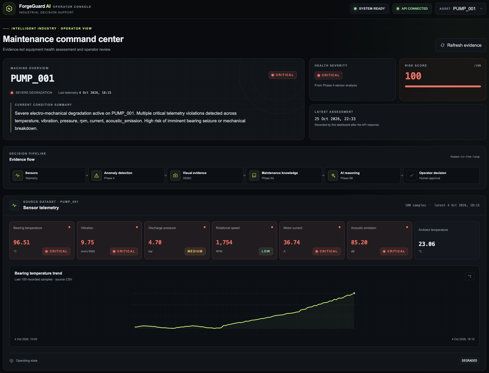
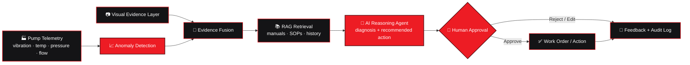

<div align="center">

# ⚙️ ForgeGuard AI — Predictive Industrial Maintenance Intelligence

### *An AI-first maintenance platform that detects machine anomalies, retrieves the right procedures, reasons about root cause, and keeps a human engineer in control of every action.*

<br />

[](https://www.amd.com)
[](https://rocm.docs.amd.com)
[](https://fastapi.tiangolo.com)
[](https://nextjs.org)
[](#-testing)
[](LICENSE)

<br />

**[The Problem](#-the-problem-maintenance-that-reacts-too-late) • [Pipeline](#-perception--decision--action-pipeline) • [Features](#-core-capabilities) • [Human-in-the-Loop](#-human-in-the-loop-approval) • [AMD Roadmap](#-amd-instinct--rocm-roadmap) • [Quickstart](#-quickstart) • [Architecture](#-architecture)**

<br />



</div>

---

## ⚡ The Problem: Maintenance That Reacts Too Late

Industrial pumps, motors, and compressors rarely fail without warning. The warning is just buried:

- **Sensor drift** in vibration, temperature, and pressure that no one is watching in real time
- **Tribal knowledge** locked in manuals, past work orders, and the heads of senior technicians
- **Alert fatigue** — threshold alarms fire constantly, so the real ones get ignored
- **Unsafe automation** — fully autonomous "AI fixes" are a non-starter on a plant floor where a wrong action costs real money or safety

Most AI maintenance demos stop at *"anomaly detected."* That is the easy 10%. The hard 90% is: **what is it, why is it happening, what should we do, and who signs off?**

---

## 💡 The Solution: A Complete AI System, Not a Standalone Model

ForgeGuard AI is built around one idea: **most AI systems fail because of poor system design, not poor models.**

Instead of `Input → Model → Output`, ForgeGuard is structured as **Input → Perception → Decision → Action**:

| Stage | What happens | ForgeGuard component |
|---|---|---|
| **Perception** | Raw signals become structured evidence | Sensor anomaly detection + visual-evidence layer |
| **Decision** | Evidence is grounded in knowledge and reasoned over | RAG maintenance retrieval + AI reasoning agent |
| **Action** | A recommendation becomes a controlled, auditable decision | Human-in-the-loop approval workflow |

The model never acts on its own. It proposes; an engineer disposes.

---

## 🔬 Perception → Decision → Action Pipeline



```
┌────────────────────────────────────────────────────────────────────────┐
│ PERCEPTION                                                             │
│ ── Sensor stream → statistical + learned anomaly scoring               │
│ ── Visual-evidence layer attaches supporting imagery to each event     │
├────────────────────────────────────────────────────────────────────────┤
│ DECISION                                                               │
│ ── RAG retrieves the manuals, SOPs, and prior incidents that matter    │
│ ── Reasoning agent produces diagnosis, confidence, and next steps      │
├────────────────────────────────────────────────────────────────────────┤
│ ACTION                                                                 │
│ ── Nothing executes without an engineer's explicit approval            │
│ ── Every decision is logged: evidence, reasoning, approver, outcome    │
└────────────────────────────────────────────────────────────────────────┘
```

---

## 🏆 Core Capabilities

### 1. 📈 Sensor Anomaly Detection
Continuous scoring over industrial pump telemetry to catch early degradation signatures — before a threshold alarm would ever fire.

### 2. 📷 Visual-Evidence Layer
Each flagged event can carry visual evidence so the operator sees *what the machine looks like*, not just a number. In this release the visual layer is a **demonstration layer**, built to prove the integration pattern end to end.

### 3. 📚 RAG-Based Maintenance Retrieval
The agent doesn't guess from model weights. It retrieves from maintenance documentation and grounds its recommendations in sources an engineer can open and verify.

### 4. 🧠 AI Reasoning Agent
Fuses anomaly evidence, visual context, and retrieved knowledge into a structured diagnosis: probable cause, severity, recommended action, and the sources behind it.

### 5. 👷 Human-in-the-Loop Approval
A first-class workflow, not a bolt-on. See below.

### 6. 🖥️ Operator Console
A Next.js "maintenance command center" built for fast triage. One screen gives the operator:

| Panel | What it shows |
|---|---|
| **Machine overview** | Asset ID, operating state, last telemetry time, and a plain-language condition summary |
| **Health severity + risk score** | Severity badge and a 0–100 risk score derived from sensor analysis |
| **Decision pipeline** | The full evidence flow: Sensors → Anomaly detection → Visual evidence → Maintenance knowledge → AI reasoning → Operator decision |
| **Sensor telemetry** | Per-sensor cards (bearing temperature, vibration, discharge pressure, rotational speed, motor current, acoustic emission, ambient temperature) with CRITICAL / MEDIUM / LOW badges |
| **Trend chart** | Recent samples for the selected sensor, so the operator sees *how* it degraded, not just where it is now |

---

## 👷 Human-in-the-Loop Approval

In industrial settings, *"the AI decided"* is not an acceptable audit trail.

| Step | Behavior |
|---|---|
| **Propose** | Agent emits a recommendation with evidence, retrieved sources, and a confidence level |
| **Review** | Operator inspects the evidence and reasoning in the dashboard |
| **Decide** | **Approve**, **Reject**, or **Edit** the recommended action |
| **Record** | The full decision trail is stored: who, when, based on what |

Design principle: **the agent has zero execution authority.** It can only write to the approval queue.

---

## 🔴 AMD Instinct & ROCm Roadmap

ForgeGuard AI was built for the **AMD Developer Hackathon: ACT III — Intelligent Industry**. Being straightforward about where things stand:

| Milestone | Status |
|---|---|
| End-to-end pipeline (telemetry → detection → RAG → agent → approval) | ✅ Working locally |
| FastAPI backend + Next.js operator dashboard | ✅ Working locally |
| Automated test suite and local dev workflow | ✅ In place |
| Deployment and validation on **AMD Instinct** accelerators with **ROCm** | ⏳ Next — pending AMD Developer Cloud access |
| Latency / throughput benchmarks on Instinct | ⏳ After validation |

Benchmarks will be published here **only once they are measured on real hardware.**

**Why Instinct fits this workload:** retrieval embedding and agent inference are the latency-sensitive path. Keeping them on-prem or on an accelerator close to the plant is exactly the deployment shape industrial customers ask for.

---

## 🧪 Data Note

Current demos run on **synthetic industrial pump telemetry**. This is deliberate: it makes failure modes reproducible and the demo deterministic. It also means detection quality numbers from synthetic data should not be read as field performance. Validation on real or public run-to-failure datasets is on the roadmap.

---

## 🛠️ Tech Stack

| Tier | Technologies | Role |
|---|---|---|
| **Backend** | **Python 3.11+**, **FastAPI**, **Pydantic**, **Uvicorn** | Async API, evidence fusion, agent orchestration |
| **Detection** | Anomaly-detection pipeline over time-series telemetry | Perception stage |
| **Knowledge** | RAG over maintenance documents (vector store + retriever) | Grounded decision support |
| **Reasoning** | LLM-driven reasoning agent with structured outputs | Diagnosis and recommendation |
| **Frontend** | **Next.js**, **TypeScript**, **Tailwind CSS** | Operator dashboard and approval queue |
| **Target Hardware** | **AMD Instinct** + **ROCm** | Accelerated inference (validation planned) |

<!-- Fill in exact libraries (vector DB, model, anomaly method) to match the repo. -->

---

## 🏁 Quickstart

### 1. Prerequisites
- Python 3.11+
- Node.js 18+ and npm

### 2. Clone
```bash
git clone https://github.com/YOUR_USERNAME/forgeguard-ai.git
cd forgeguard-ai
```

### 3. Environment
```bash
cp .env.example .env
# edit .env with your model / API configuration
```

### 4. Run the Backend
```bash
cd backend
python3 -m venv .venv
source .venv/bin/activate
pip install -r requirements.txt
uvicorn app.main:app --reload --port 8000
```
- API docs: http://localhost:8000/docs

### 5. Run the Dashboard
```bash
cd frontend
npm install
npm run dev
```
- Dashboard: http://localhost:3000

---

## 🧪 Testing

```bash
cd backend
.venv/bin/pytest tests -v
```

---

## 🏗️ Architecture

```
forgeguard-ai/
├── backend/
│   ├── app/
│   │   ├── api/            # FastAPI routers
│   │   ├── detection/      # Anomaly detection over telemetry
│   │   ├── evidence/       # Visual-evidence layer
│   │   ├── rag/            # Ingestion, embeddings, retrieval
│   │   ├── agent/          # Reasoning agent + structured outputs
│   │   ├── approval/       # Human-in-the-loop workflow + audit trail
│   │   └── core/           # Config, logging
│   ├── tests/
│   └── requirements.txt
│
├── frontend/               # Next.js operator dashboard
│   ├── app/
│   ├── components/
│   └── lib/
│
├── data/                   # Synthetic telemetry + sample maintenance docs
├── docs/assets/            # Dashboard screenshot, diagrams
├── .env.example
└── README.md
```

<!-- Adjust folder names to match the actual repo layout. -->

---

## ⚖️ Design Trade-offs

| Decision | Why | Trade-off |
|---|---|---|
| Human approval on every action | Safety, accountability, trust | Slower than full automation; throughput bound by operators |
| RAG instead of fine-tuning | Updatable without retraining; sources are citable | Retrieval quality becomes a critical failure point |
| Synthetic telemetry first | Reproducible demos, fast iteration | Real-world accuracy unproven until validated on field data |
| Evidence fusion before the agent | Agent reasons over structured evidence, not raw streams | Added pipeline complexity and a new place for bugs |

---

## 🗺️ Roadmap

- [x] Anomaly detection on synthetic pump telemetry
- [x] RAG maintenance retrieval
- [x] Reasoning agent + approval workflow
- [x] Operator dashboard
- [ ] Validate on AMD Instinct with ROCm
- [ ] Publish measured latency and throughput benchmarks
- [ ] Evaluate on real / public run-to-failure datasets
- [ ] Retrieval and agent evaluation harness (groundedness, recommendation accuracy)
- [ ] Observability: tracing, drift monitoring, agent decision metrics

---

## 👥 Team

| | |
|---|---|
| **Linghuraj Periyaswamy Ramani** | AI Engineer · Founder & CEO, [QuantyNex](https://github.com/YOUR_USERNAME) |
| **Daakshayani** | Co-builder |

Built for the **AMD Developer Hackathon: ACT III — Intelligent Industry**.

---

## 📄 License

Licensed under the **MIT License**. See [LICENSE](LICENSE).

<div align="center">
<sub>Built with ❤️‍🔥 for the AMD Developer Hackathon community — because the best maintenance is the failure that never happens.</sub>
</div>
